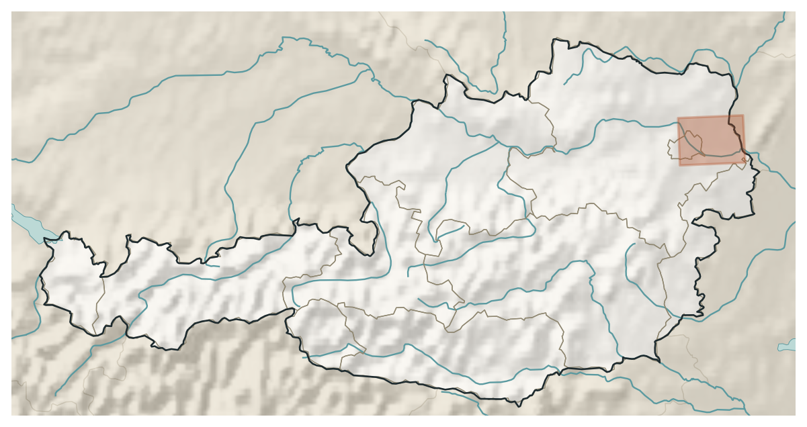

::: {.drought-stripe}
:::

In November 2026 Austria's agriculture ministry reported that the previous twelve months had been the
driest since measurements began in 1850
([BMLUK, 2026](https://www.bmluk.gv.at/service/presse/landwirtschaft/2026/totschnig-duerre-katastrophe-2026-ist-gemeinsame-herausforderung-fuer-eu-landwirtschaft.html)).
Few places feel that more than the **Marchfeld**, the plain between Vienna, the Danube and the March:
Austria's main arable region, roughly 500–550 mm of rain a year, and a patchwork of rainfed and
groundwater-irrigated fields.

This tutorial shows how to see that drought from space with free data and open-source Python. The core is
**monthly median composites** from **Sentinel-2** and **Landsat**, from which we derive spectral indices
(NDVI, EVI, NDMI, MSI, land-surface temperature) and drought indicators (anomalies, z-scores, the share of
the area under stress). **MODIS** adds the 25-year record needed for the Vegetation, Temperature and
Vegetation Health condition indices. **ERA5** SPI and SPEI provide the climate context.



## The workflow

| Step | Data | Result |
|---|---|---|
| Monthly median composites | Sentinel-2 L2A (20 m), Landsat 8/9 C2 L2 (30 m) | one clean image per month, with clear-observation counts |
| Spectral indices | composites | NDVI, EVI, NDMI, MSI, NDWI, land-surface temperature |
| Drought indicators | indices vs the same month in reference years | anomalies, z-scores, VCI, area under stress |
| Long-term condition | MODIS NDVI and LST, 2001– | VCI, TCI, VHI maps for eastern Austria [@kogan1995] |
| Climate context | ERA5 via Open-Meteo | SPI [@mckee1993], SPEI [@vicente2010] |

## How the material is organised

The [tutorial](tutorial.qmd) is the methods guide; the [slides](presentation.html) gives a quick overview and summary of the key concepts. Two notebooks do the hands-on work:
[Notebook 1](notebooks/01_monthly_composites.ipynb) builds Sentinel-2 and Landsat monthly composites for
the Marchfeld, from cloudy scenes to a multi-year cube;
[Notebook 2](notebooks/02_indices_from_composites.ipynb) derives indices and drought indicators from them
and maps field-scale stress; 
<!-- [Notebook 3](notebooks/03_modis_condition_indices.ipynb) computes MODIS VCI,
TCI and VHI for eastern Austria and compares the Marchfeld with ERA5 SPI and SPEI. -->

All code lives in [`droughtkit`](https://github.com/khizerzakir/drought-indicators/tree/main/droughtkit), a
short teaching library in this repository built on `xarray`, `odc-stac`, `pystac-client`,
`planetary-computer`, `scipy` and `geopandas`. Nothing else is required.

## Austrian open data

The tutorial uses global datasets so that it can be repeated anywhere. For work in Austria, these national
sources add detail and independent evidence:

| Dataset | Provider | What it offers |
|---|---|---|
| [INVEKOS field parcels](https://www.data.gv.at) | AMA | crop type and geometry of every agricultural field |
| [SPARTACUS](https://data.hub.geosphere.at) | GeoSphere Austria | 1 km daily precipitation, temperature and sunshine since 1961 [@hiebl2018] |
| [WINFORE](https://data.hub.geosphere.at) | GeoSphere Austria | 1 km reference evapotranspiration and SPEI |
| [eHYD](https://ehyd.gv.at) | Hydrographic Service, BML | groundwater levels, river discharge, precipitation stations |
| [ARIS](https://warndienst.lko.at/trockenheitsmonitoring-und-vorhersagesystem-aris+2500+1073326) | BOKU and partners | operational 1 km crop-drought monitoring and forecasts |

## Inspiration and further tools

The tutorial was inspired by several open projects. None of them is used by the code here, but each is
worth knowing if you want to go further:

- [monocongo/climate_indices](https://github.com/monocongo/climate_indices): reference implementations of
  SPI, SPEI, PET and Palmer indices for points and NetCDF grids.
- [TerziTB/PyDRGHT](https://github.com/TerziTB/PyDRGHT): standardised and classical drought indices,
  drought characteristics and copula-based frequency analysis [@terzi2025].
- [bennyistanto/eddi](https://github.com/bennyistanto/eddi): the Evaporative Demand Drought Index on grids.
- [mintproject/droughtIndices](https://github.com/mintproject/droughtIndices): a model wrapper for drought
  indices from precipitation and temperature.
- [Laura-Guillory/DroughtMonitor](https://github.com/Laura-Guillory/DroughtMonitor): the Australian
  Combined Drought Indicator from percentile-ranked rainfall, soil moisture, evapotranspiration and NDVI.
- [EUMETSAT Drought & Vegetation Data Cube](https://gitlab.eumetsat.int/eumetlab/climate/scale/climate-system-monitoring/terrestrial/drought-and-vegetation-data-cube):
  satellite soil moisture, LST, FAPAR and related records on a common grid for Europe.
- Di Paola et al. (2025), *Building a framework for a synoptic overview of drought* [@dipaola2025]:
  multi-scale SPI views and drought propagation at basin scale.

## Running it

```bash
python -m venv .venv && source .venv/bin/activate   # Windows: .venv\Scripts\Activate.ps1
pip install -r requirements.txt
jupyter lab notebooks/
```

The notebooks also work offline. If Planetary Computer or Open-Meteo cannot be reached, clearly labelled
synthetic stand-ins replace the downloads: a Marchfeld-like block of fields with rainfed and irrigated
crops, and a MODIS-like record for eastern Austria. The outputs stored in the repository were produced that
way. Run the notebooks with internet access to see real data, then `python scripts/make_figures.py` to
refresh the figures used here and in the slides.
