## Austria has just had its driest twelve months since 1850

::: {.columns}
::: {.column width="56%"}
::: {.lead}
In November 2026 the agriculture ministry reported that the previous twelve months were the driest since
measurements began in 1850, and agreed an emergency aid package for farms.
:::

::: {.lead style="margin-top:.8em"}
This lecture asks a practical question: **what can free satellite data tell us about that drought, field
by field and month by month?**
:::

::: {.source style="margin-top:1.4em"}
BMLUK press release, 2026: "Dürre-Katastrophe 2026 ist gemeinsame Herausforderung für EU-Landwirtschaft".
:::
:::
::: {.column width="44%"}
::: {.statement style="font-size:1.2em; color:#b5542d"}
Satellites do not see drought. They see plants losing green biomass, canopies losing water, and surfaces
heating up.
:::

::: {.small .muted style="margin-top:.8em"}
Those signals become drought indicators only when compared with what is normal for that place and that
time of year.
:::
:::
:::

## The Marchfeld: Austria's breadbasket, and one of its driest corners

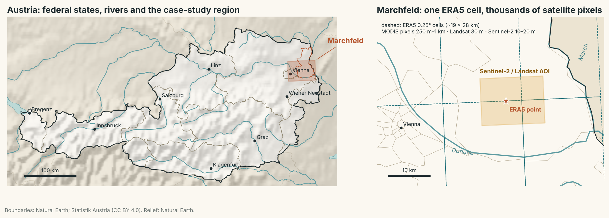{.fullwidth}

::: {.small}
Between Vienna, the Danube and the March: large arable fields, roughly 500–550 mm of rain a year, and many
fields irrigated from groundwater. One ERA5 climate cell covers the whole satellite study area.
:::

## Three sensors, three roles

| | Sentinel-2 L2A | Landsat 8/9 C2 L2 | MODIS Terra |
|---|---|---|---|
| Pixel size | 10–20 m | 30 m, thermal 100 m | 250 m–1 km |
| Revisit | 5 days | 8 days | daily |
| Record | 2015– | 2013– | 2000– |
| Used for | field-scale indices and anomalies | land-surface temperature, second optical sensor | 25-year baselines: VCI, TCI, VHI |

::: {.small style="margin-top:1em"}
All three come free from Microsoft Planetary Computer through STAC, without an account. `odc-stac` reads
only the pixels of the area of interest. ERA5 rainfall and evaporative demand add the climate context.
:::

## {.section-slide background-gradient="linear-gradient(135deg, #0f3f4a 0%, #1f6f78 100%)"}

[01]{.num}

[Monthly composites]{.sec-title}

From hundreds of cloudy scenes to one clean image per month.

## A composite is built in four steps

::: {.columns}
::: {.column width="36%"}
1. **Search** all scenes of the month for the area.
2. **Mask** every pixel: Sentinel-2 SCL classes 4–6, Landsat QA_PIXEL bits.
3. **Harmonise and scale**: remove the Sentinel-2 +1000 offset (since January 2022); scale Landsat
   Collection 2.
4. **Median** of all clear observations, and count them.
:::
::: {.column width="64%"}
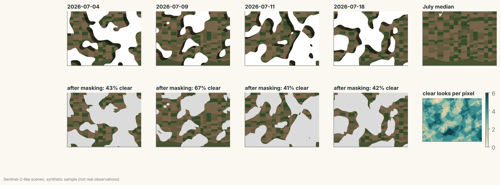
:::
:::

::: {.source}
The median also drops cloud edges and haze the mask misses. Months without a clear look stay empty.
:::

## One composite per month gives a regular time axis

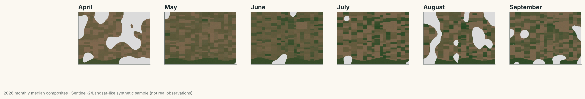{.fullwidth}

::: {.small}
Winter cereals ripen and are harvested in June and July, while maize, sugar beet and vegetables green up.
The irrigated fields stay green all summer. Grey pixels had no clear observation that month.
:::

## The same code for both sensors

::: {.columns}
::: {.column width="45%"}
::: {.small}
Bands are renamed to common names (blue, green, red, nir, swir1, swir2) and scaled to reflectance, so
Sentinel-2 and Landsat feed the same functions.

One year at a time is loaded, composited and cached, so a ten-year record builds up step by step and
re-runs are instant.
:::
:::
::: {.column width="55%"}
```python
import droughtkit as dk
from droughtkit import remote_sensing as rs

bbox = dk.MARCHFELD["bbox"]
s2 = rs.monthly_cube("sentinel2", bbox,
                     years=range(2017, 2027),
                     months=range(4, 10))
ls = rs.monthly_cube("landsat", bbox,
                     years=range(2017, 2027),
                     months=range(4, 10))
```
:::
:::

## {.section-slide background-gradient="linear-gradient(135deg, #6b2410 0%, #b5542d 100%)"}

[02]{.num}

[Indices and indicators]{.sec-title}

From reflectance to "this field is unusually stressed for July".

## Each index sees a different part of the response

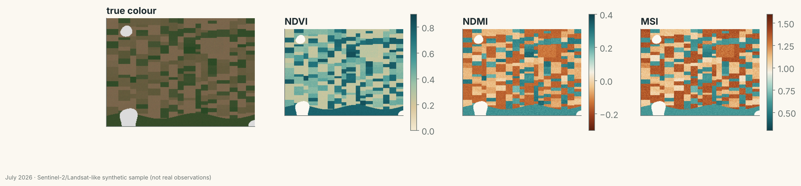{.fullwidth}

| Index | Formula | Signal | In drought |
|---|---|---|---|
| NDVI | (NIR − red) / (NIR + red) | green biomass | falls |
| NDMI | (NIR − SWIR1) / (NIR + SWIR1) | canopy water | falls, often first |
| MSI | SWIR1 / NIR | moisture stress | rises |
| LST | Landsat thermal | surface heat | rises |

## Normal depends on the month

::: {.columns}
::: {.column width="58%"}
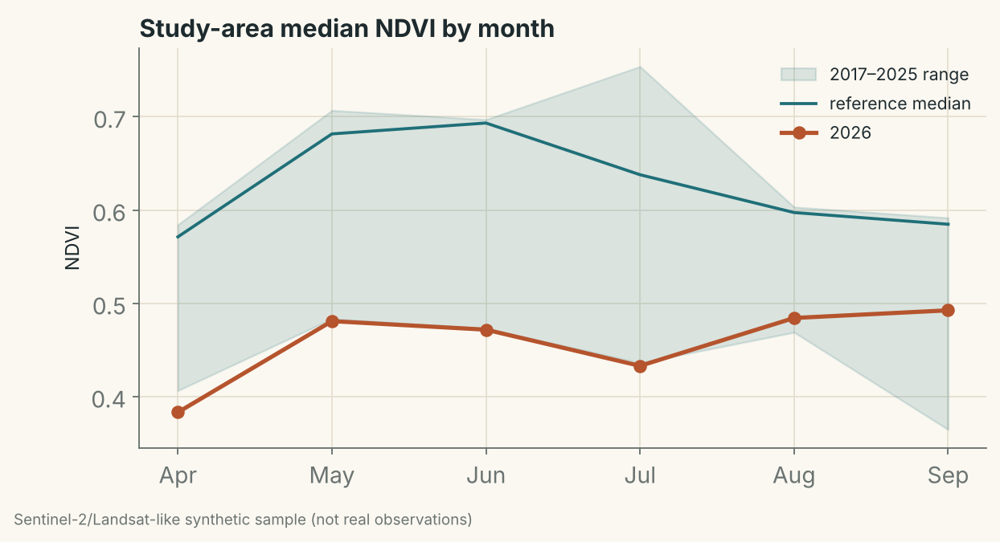
:::
::: {.column width="42%"}
::: {.small}
An NDVI of 0.3 in July is normal for a harvested wheat field and alarming for maize.

So every indicator compares a pixel with **the same calendar month** in a set of reference years: here
2017–2025 for Sentinel-2.

The shaded band is the reference range for the whole study area; the red line is 2026.
:::
:::
:::

## Anomalies and z-scores show where, field by field

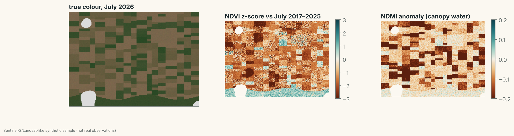{.fullwidth}

::: {.small}
The z-score divides the anomaly by the year-to-year variability of that pixel and month. Rainfed fields
drop well below their usual July values; irrigated fields stay close to normal.
:::

## A map becomes a number: the area under stress

::: {.columns}
::: {.column width="62%"}
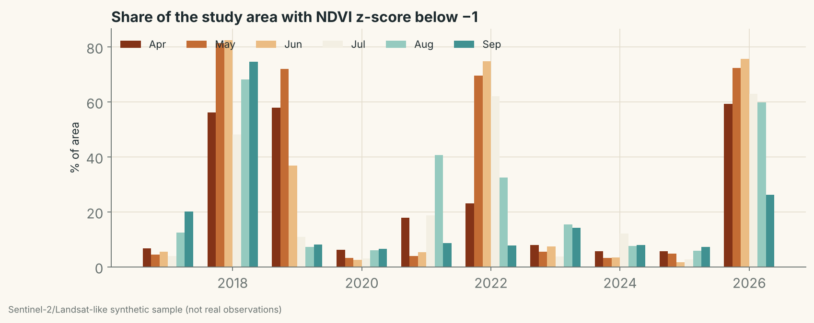
:::
::: {.column width="38%"}
::: {.small}
The share of the study area with an NDVI z-score below −1, per month, condenses each season into one line
and makes 2026 directly comparable with 2018 or 2022.

```python
ndvi_z = dk.anomaly(idx.NDVI, (2017, 2025),
                    standardize=True)
dk.area_below(ndvi_z, -1)
```
:::
:::
:::

## Before calling a brown field a drought field

::: {.columns}
::: {.column width="50%"}
- **Crop calendar.** Winter cereals are harvested by mid-July; a brown cereal field in late July is normal.
- **Rotation.** Last year's maize field may be this year's wheat.
- **Irrigation.** Keeps fields green through a meteorological drought.
- **Coverage.** A month with few clear looks is a weak basis.
:::
::: {.column width="50%"}
::: {.sidenote}
The INVEKOS field parcels published by AMA give the crop of every field in Austria. Overlaying them turns
pixel anomalies into anomalies per crop, which is what farmers and advisors can act on.
:::
:::
:::

## {.section-slide background-gradient="linear-gradient(135deg, #1d2a2e 0%, #6b4a1f 100%)"}

[03]{.num}

[MODIS: the long view]{.sec-title}

Is this summer unusual in 25 years, and how far does it reach?

## Condition indices need a long record

::: {.columns}
::: {.column width="58%"}
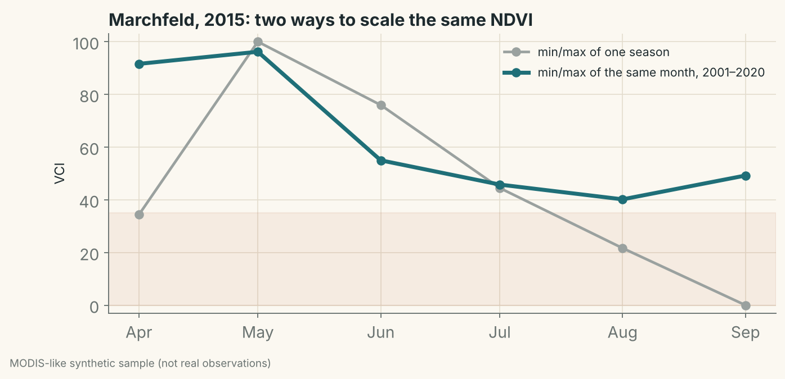
:::
::: {.column width="42%"}
::: {.small}
Kogan's indices place each month between the lowest (0) and highest (100) value of the same month on
record:

$$\mathrm{VCI} = 100\,\frac{\mathrm{NDVI}-\mathrm{NDVI}_{\min,m}}{\mathrm{NDVI}_{\max,m}-\mathrm{NDVI}_{\min,m}}$$

TCI does the same for land-surface temperature, inverted; VHI is their mean. Nine years of Sentinel-2 are
too short for a stable minimum and maximum; MODIS has 25. Scaling by a single season, in grey, turns
phenology into "drought".
:::
:::
:::

## MODIS VCI, TCI and VHI for eastern Austria

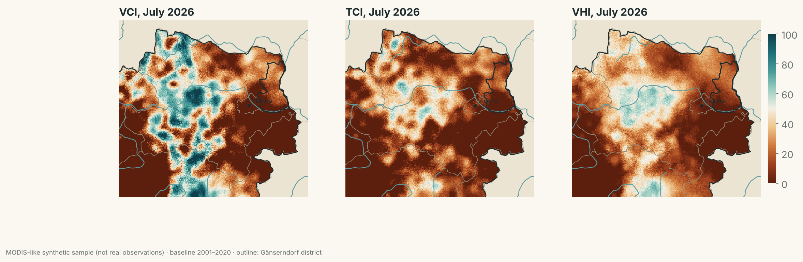{.fullwidth}

::: {.small}
VCI shows the accumulated effect on vegetation; TCI reacts within days to heat and lost evaporative cooling.
Forested hills often show a TCI signal before any VCI signal. Outline: Gänserndorf district.
:::

## July in six drought and non-drought years

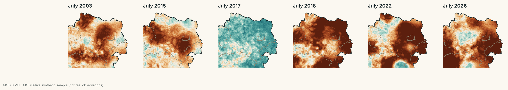{.fullwidth}

::: {.small}
The same scale and baseline make years directly comparable. VHI below 40 is commonly read as drought
stress, a convention rather than a physical threshold.
:::

## Climate context: SPI and SPEI from ERA5

::: {.columns}
::: {.column width="62%"}
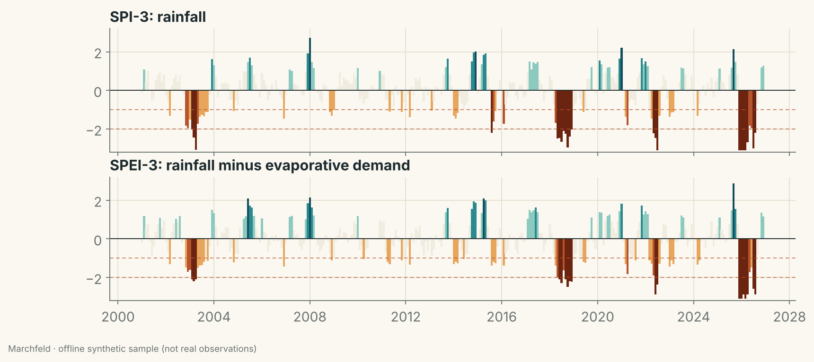
:::
::: {.column width="38%"}
::: {.small}
Satellites show the effect; climate indices show the cause.

**SPI** expresses accumulated rainfall as a standard-normal value for that month (McKee et al. 1993).
**SPEI** does the same for rainfall minus evaporative demand, so heat counts too (Vicente-Serrano et al.
2010). Below −1 is moderately dry, below −2 extremely dry.

Correlating the Marchfeld VHI with SPEI shows that its crops integrate the water balance over about one to
three months.
:::
:::
:::

## Report it so that others can reproduce it

| Item | Example for the Marchfeld |
|---|---|
| Sensors and processing level | Sentinel-2 L2A, Landsat 8/9 C2 L2, MOD13A1 / MOD11A2 v061 |
| Masking and harmonisation | SCL 4–6; QA_PIXEL bits 0–5; Sentinel-2 offset removed |
| Compositing | monthly median of clear observations; clear-look count reported |
| Indices and indicators | NDVI and NDMI z-scores; VCI, TCI, VHI |
| Reference periods | 2017–2025 (Sentinel-2), 2001–2020 (MODIS), 1991–2020 (SPI/SPEI) |
| Validation | INVEKOS crop types, yields, eHYD groundwater levels |

## Hands-on

1. **Monthly composites.** Cloudy Sentinel-2 scenes to a masked median; a ten-year monthly cube from
   Sentinel-2 and Landsat; coverage; the two sensors compared.
2. **Indices and indicators.** NDVI, EVI, NDMI, MSI and LST; seasonal cycle; anomaly and z-score maps;
   condition indices; the area under stress.
3. **MODIS and climate context.** VCI, TCI and VHI maps for eastern Austria; July in different years; the
   Marchfeld through the seasons; SPI and SPEI from ERA5.

::: {.small .muted style="margin-top:1em"}
All notebooks also run offline with clearly labelled synthetic stand-ins, and switch to real data when online.
:::

## Take-home

::: {.statement style="font-size:1.35em"}
Composite first, compare with the same month, read several indices together.
:::

::: {.small style="margin-top:1.2em"}
- Mask every scene, harmonise, take the monthly median, and report coverage.
- Greenness, canopy water and surface temperature respond differently: use all three.
- Sentinel-2 and Landsat show where; MODIS shows how unusual; ERA5 shows why.
- Check crop calendars, rotation and irrigation before calling a field stressed.
:::

## References and inspiration {.smaller}

::: {style="font-size:.74em; line-height:1.4"}
Gao (1996) *Remote Sens. Environ.* 58, 257–266 · Hersbach et al. (2020) *QJRMS* 146, 1999–2049 ·
Kogan (1995) *Adv. Space Res.* 15(11), 91–100 · McFeeters (1996) *Int. J. Remote Sens.* 17, 1425–1432 ·
McKee et al. (1993) 8th Conf. Appl. Climatol., 179–184 · Vicente-Serrano et al. (2010) *J. Climate* 23,
1696–1718 · Vicente-Serrano et al. (2013) *PNAS* 110, 52–57.

Inspiration and further tools (not used by the course code): monocongo/climate_indices · TerziTB/PyDRGHT ·
bennyistanto/eddi · mintproject/droughtIndices · Laura-Guillory/DroughtMonitor · EUMETSAT Drought &
Vegetation Data Cube · Di Paola et al. (2025) *Sci. Total Environ.* 958, 177949.

Data: Sentinel-2 (Copernicus), Landsat (USGS) and MODIS (NASA) via Microsoft Planetary Computer; ERA5 via
Open-Meteo; boundaries from Natural Earth and Statistik Austria. Figures marked "synthetic" are offline
stand-ins; run the notebooks online and `python scripts/make_figures.py` to replace them.
:::
